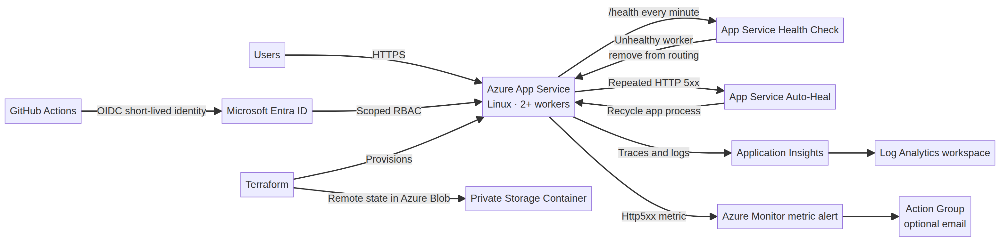

# Self-Healing Web App on Azure

A reproducible infrastructure portfolio project that deploys a small Python web app to Azure App Service and demonstrates **detection, traffic isolation, recovery, telemetry, alerting, and secrets-free CI/CD**. Azure resources are defined in Terraform. GitHub Actions authenticates to Azure with OpenID Connect (OIDC), not a client secret or publish profile.

> **Cost and safety:** Terraform provisions billable Azure services. The default plan is Premium v3 with two workers so health-based traffic removal can leave a healthy instance serving requests. This is intentionally a resilient demonstration footprint, not a free-tier deployment. Review the plan and Azure pricing for your region before applying. CI only validates code. Infrastructure changes require a manual workflow run and an explicit `confirm_apply: true`. The app deploy workflow is also manual. No Azure deployment is run by this repository setup.

## Architecture



Editable diagram source: [`docs/architecture.mmd`](docs/architecture.mmd).

The health check and auto-heal are complementary. The health endpoint informs App Service routing so traffic can be removed from an unhealthy worker. The auto-heal rule recycles the app process after repeated HTTP 5xx responses. Azure Monitor alerts operations; the alert itself is **not** an automatic restart action. Application Insights and Log Analytics provide telemetry for diagnosis.

With two or more workers, health-based removal can preserve service while a bad worker recovers. Health Check may replace a worker only within Azure's platform limits. It does not guarantee zero downtime, and the sample has no database, queue, or cross-region failover.

## Repository map

- `infra/` — AzureRM Terraform configuration, inputs, outputs, and example values.
- `app/` — Flask sample app with `/health`, `/live`, `/ready`, and an opt-in failure simulation route.
- `.github/workflows/ci.yml` — Python tests and Terraform formatting/validation, no Azure credentials.
- `.github/workflows/terraform.yml` — manual OIDC-based plan; apply requires an explicit boolean input.
- `.github/workflows/deploy-app.yml` — manual ZIP deployment through Azure CLI after OIDC login.
- `docs/` — operations runbook and design decisions.

## Prerequisites

- An Azure subscription and a principal allowed to create the listed resources.
- Azure CLI, Terraform 1.9.x, Python 3.12, and Git for local work.
- A globally unique Web App name.
- GitHub Actions enabled and an environment named `production` recommended for deployment approvals.
- For CI deployment, a Microsoft Entra application/service principal with a federated identity credential restricted to this repository and the `production` environment. Assign only the required Azure RBAC roles. Do not create a client secret.
- A private Azure Storage account/container for Terraform state. Give the federated identity Storage Blob Data Contributor on the state container. Protect the storage account with restricted access, soft delete/versioning per your policy, and backups.

## Configure GitHub variables

Set these as repository or `production` environment **variables** (they are identifiers, not credentials):

| Variable | Purpose |
| --- | --- |
| `AZURE_CLIENT_ID` | Entra app/service principal client ID used by OIDC. |
| `AZURE_TENANT_ID` | Entra tenant ID. |
| `AZURE_SUBSCRIPTION_ID` | Target Azure subscription ID. |
| `TF_STATE_RESOURCE_GROUP` | Resource group containing the state Storage account. |
| `TF_STATE_STORAGE_ACCOUNT` | Existing Storage account name for remote state. |
| `TF_STATE_CONTAINER` | Private blob container for state. |
| `TF_STATE_KEY` | State blob name, e.g. `self-healing-web-app.tfstate`. |
| `APP_RESOURCE_GROUP` | Resource group created by Terraform (for app deployment). |
| `APP_SERVICE_NAME` | Globally unique App Service name created by Terraform. |

No Azure password, service-principal secret, or publish-profile secret is needed. Restrict the OIDC trust subject to `repo:OWNER/REPOSITORY:environment:production`; do not use a wildcard subject. Give the OIDC identity only the permissions required to provision this project's resources and write its state. The first Terraform identity may need broader permissions to create role-bound services; scope RBAC as tightly as practical.

## Run locally

1. Sign in with Azure CLI: `az login` and select the subscription with `az account set --subscription <subscription-id>`. Create the separate state account with `scripts/bootstrap-state.sh <location> <state-resource-group> [subscription-id]`, or use an existing private account and container.
2. Copy `infra/terraform.tfvars.example` to `infra/terraform.tfvars`. Set `subscription_id` and a globally unique `web_app_name`; keep failure simulation disabled.
3. Configure the Azure Storage backend. The backend block is intentionally partial. From `infra/`, initialize with the state resource group, account, container, and key. For local Azure CLI auth, use `-backend-config="use_azuread_auth=true"`; the workflow configures OIDC explicitly. Example:

   ```bash
   cd infra
   terraform init \
     -backend-config="resource_group_name=$TF_STATE_RESOURCE_GROUP" \
     -backend-config="storage_account_name=$TF_STATE_STORAGE_ACCOUNT" \
     -backend-config="container_name=$TF_STATE_CONTAINER" \
     -backend-config="key=self-healing-web-app.tfstate" \
     -backend-config="use_azuread_auth=true"
   ```

   Do not commit backend configuration containing account details if your policy treats them as sensitive.
4. Run `terraform fmt -recursive`, `terraform validate`, and `terraform plan`.
5. Review the plan, expected resource count, region, SKU, worker count, and estimated costs. Apply only when you are ready to create billable resources.
6. Deploy the app using `.github/workflows/deploy-app.yml` after setting the GitHub variables and OIDC trust. Then verify the URL and `/health` output.

The Azure Storage backend uses Azure Blob leases for state locking. Keep state remote and encrypted; never check `terraform.tfstate`, `terraform.tfstate.backup`, `.terraform/`, `terraform.tfvars`, or plan artifacts into Git.

## GitHub Actions flow

Pull requests and pushes to `main` run app unit tests and Terraform static checks. Those jobs have read-only repository permissions and no Azure access. Run `Terraform` from the Actions tab to create a plan. Leave `confirm_apply` false to plan only. Set it true only after reviewing the plan and accepting its cost and impact. Configure required reviewers on the GitHub `production` environment for an additional approval gate.

Run `Deploy app` manually after infrastructure exists. The job gets a short-lived OIDC token, builds a ZIP package, and deploys using Azure CLI. It does not use App Service publishing credentials.

## Failure demonstration

The production-safe default keeps `ENABLE_FAILURE_SIMULATION=false` and the target instance ID unset. In a disposable test environment only, set `enable_failure_simulation = true` in your Terraform variables, apply, and deploy. Query `/demo/instance` repeatedly to see worker IDs, then set Terraform input `failure_target_instance_id` to exactly one worker ID and apply. Only that instance returns 503 from `/health`; other workers remain healthy and can continue serving traffic while Health Check removes the bad worker from routing. Observe the Auto-Heal threshold and Azure Monitor alert as the exercise progresses. Clear the target and set the Terraform option back to false afterward. App setting changes can restart the app; if instance IDs change, query them again before targeting.

Do not expose the diagnostic or failure routes in production. Both are disabled (404) by default and remain instructional fault-injection controls, not an attack simulator. Health check changes or configuration changes can restart the app.

## Clean up

After preserving any evidence needed for your portfolio, run `terraform destroy` from `infra/` with the same backend and variables. Review the destroy plan first. The state Storage account is separate and is not destroyed by this project. Retain or delete it deliberately according to your state-retention policy.

## Validation status

The repository includes app unit tests and CI definitions. Run the workflow or use the local commands above after cloning. Terraform deployment and Azure behavior require an Azure subscription; they are not represented as completed until you run them.

## References

- [Azure App Service Health Check](https://learn.microsoft.com/en-us/azure/app-service/monitor-instances-health-check)
- [Terraform Azure Linux Web App](https://registry.terraform.io/providers/hashicorp/azurerm/latest/docs/resources/linux_web_app)
- [Terraform Azure Monitor metric alert](https://registry.terraform.io/providers/hashicorp/azurerm/latest/docs/resources/monitor_metric_alert)
- [Terraform AzureRM backend](https://developer.hashicorp.com/terraform/language/backend/azurerm)
- [Azure Login GitHub Action with OpenID Connect](https://github.com/Azure/login#login-with-openid-connect-oidc-recommended)
